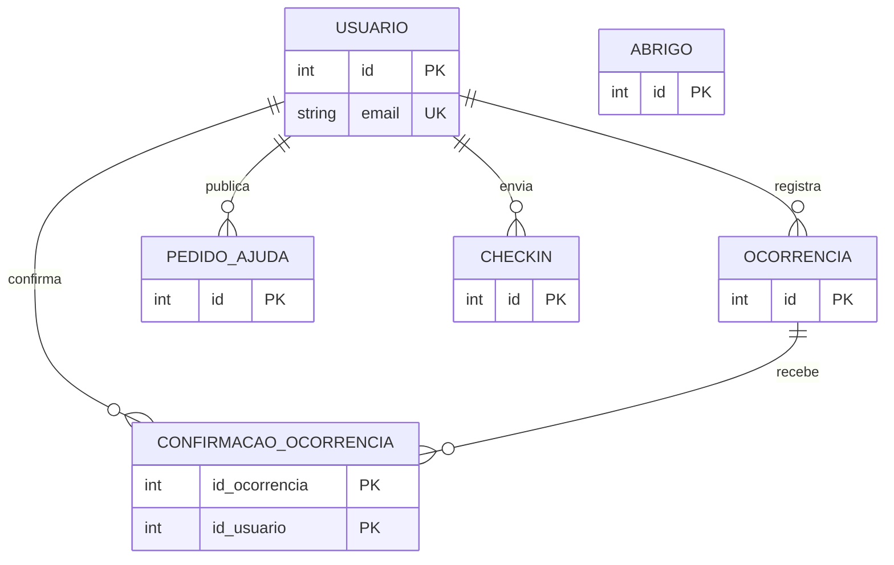
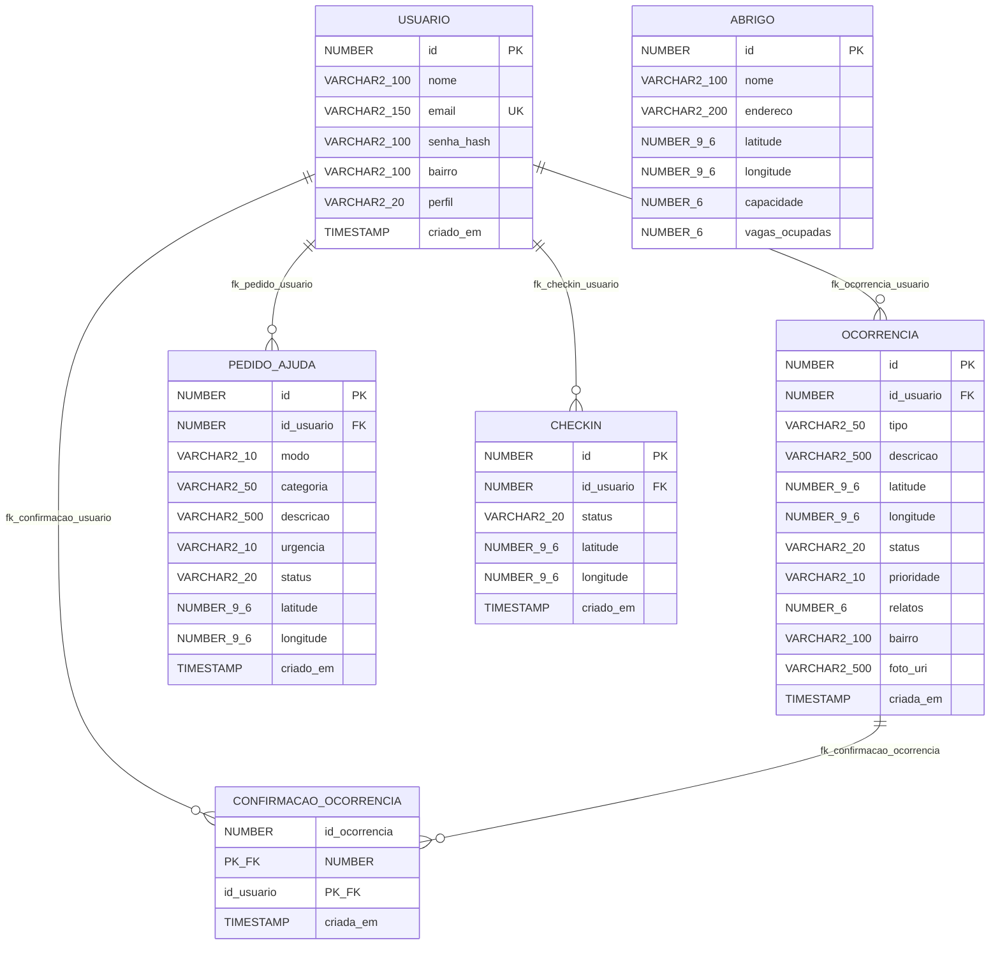

# Modelo de dados — AlertaBairro

Oracle. Seis entidades, com o DER físico, o MER conceitual e o dicionário de dados
extraído do próprio banco (`user_tab_columns`), não transcrito de memória.

---

## 1. MER — modelo conceitual

Entidades, atributos de identificação e as cardinalidades, em notação Chen.

| Relacionamento | Cardinalidade | Leitura |
|---|---|---|
| `USUARIO` → `OCORRENCIA` | 1 : N | um morador registra zero ou muitas ocorrências; cada ocorrência tem exatamente um autor |
| `USUARIO` → `PEDIDO_AJUDA` | 1 : N | um morador publica zero ou muitos pedidos ou ofertas |
| `USUARIO` → `CHECKIN` | 1 : N | um morador envia zero ou muitos check-ins ao longo do tempo |
| `USUARIO` × `OCORRENCIA` | N : N | "também vejo isso aqui" — resolvido pela entidade associativa `CONFIRMACAO_OCORRENCIA` |
| `ABRIGO` | — | sem relacionamento, de propósito |

### Por que `ABRIGO` não se liga a ninguém

O app não cadastra abrigos e ninguém é "dono" de um abrigo. A ligação entre pessoas e
abrigos é **geográfica e calculada no momento da pergunta** — `fn_abrigo_mais_proximo`
recebe a coordenada de quem pergunta e devolve o abrigo com vaga mais próximo. Guardar
isso como relacionamento seria congelar uma resposta que muda a cada passo que a pessoa dá.

### Por que a confirmação é uma entidade, e não um contador

`OCORRENCIA.relatos` poderia ser só um número. Mas a regra é "uma confirmação por pessoa
por ocorrência", e um contador não sabe **quem** já confirmou. A entidade associativa, com
chave primária composta `(id_ocorrencia, id_usuario)`, faz o próprio banco recusar a
segunda tentativa com `ORA-00001` — a regra existe mesmo que alguém escreva por fora da API.

---

## 2. DER — modelo físico

---

## 3. Dicionário de dados

Tipos e nulidade conforme `user_tab_columns`. Todas as colunas de texto são medidas em
**caracteres**, não bytes — ver a seção 5.

### USUARIO

| Coluna | Tipo | Nulo | Default | Descrição |
|---|---|---|---|---|
| `id` | `NUMBER` | NOT NULL | `seq_usuario` via trigger | PK |
| `nome` | `VARCHAR2(100 CHAR)` | NOT NULL | — | nome exibido no app |
| `email` | `VARCHAR2(150 CHAR)` | NOT NULL | — | login; único, e único também ignorando caixa |
| `senha_hash` | `VARCHAR2(100 CHAR)` | NOT NULL | — | bcrypt custo 10 (60 caracteres); nunca sai da API |
| `bairro` | `VARCHAR2(100 CHAR)` | NOT NULL | — | herdado pelas ocorrências que a pessoa registra |
| `perfil` | `VARCHAR2(20 CHAR)` | NOT NULL | — | `morador` · `idoso` · `voluntario` |
| `criado_em` | `TIMESTAMP(6)` | NOT NULL | `SYSTIMESTAMP` | — |

### OCORRENCIA

| Coluna | Tipo | Nulo | Default | Descrição |
|---|---|---|---|---|
| `id` | `NUMBER` | NOT NULL | `seq_ocorrencia` via trigger | PK |
| `id_usuario` | `NUMBER` | NOT NULL | — | FK → `USUARIO`; **nunca sai da API** (ver `meu`) |
| `tipo` | `VARCHAR2(50 CHAR)` | NOT NULL | — | `Alagamento` · `Árvore caída` · `Sem luz` · `Deslizamento` |
| `descricao` | `VARCHAR2(500 CHAR)` | NOT NULL | — | texto livre do morador |
| `latitude` | `NUMBER(9,6)` | NOT NULL | — | −90 a 90, com CHECK |
| `longitude` | `NUMBER(9,6)` | NOT NULL | — | −180 a 180, com CHECK |
| `status` | `VARCHAR2(20 CHAR)` | NOT NULL | `'aberta'` | `aberta` · `em_atendimento` · `resolvida`; só avança |
| `prioridade` | `VARCHAR2(10 CHAR)` | NOT NULL | `'normal'` | `normal` · `alta` · `critica`; sobe pelo trigger |
| `relatos` | `NUMBER(6)` | NOT NULL | `1` | autor + confirmações; inteiro, sem fração |
| `bairro` | `VARCHAR2(100 CHAR)` | NULL | — | copiado do autor pela procedure (desnormalização intencional) |
| `foto_uri` | `VARCHAR2(500 CHAR)` | NULL | — | caminho no aparelho; limite conhecido (seção 5) |
| `criada_em` | `TIMESTAMP(6)` | NOT NULL | `SYSTIMESTAMP` | base do "há X min" do app |

### ABRIGO

| Coluna | Tipo | Nulo | Default | Descrição |
|---|---|---|---|---|
| `id` | `NUMBER` | NOT NULL | `seq_abrigo` via trigger | PK |
| `nome` | `VARCHAR2(100 CHAR)` | NOT NULL | — | — |
| `endereco` | `VARCHAR2(200 CHAR)` | NOT NULL | — | — |
| `latitude` | `NUMBER(9,6)` | NOT NULL | — | −90 a 90, com CHECK |
| `longitude` | `NUMBER(9,6)` | NOT NULL | — | −180 a 180, com CHECK |
| `capacidade` | `NUMBER(6)` | NOT NULL | — | > 0, com CHECK |
| `vagas_ocupadas` | `NUMBER(6)` | NOT NULL | `0` | entre 0 e `capacidade`, com CHECK |

### PEDIDO_AJUDA

| Coluna | Tipo | Nulo | Default | Descrição |
|---|---|---|---|---|
| `id` | `NUMBER` | NOT NULL | `seq_pedido_ajuda` via trigger | PK |
| `id_usuario` | `NUMBER` | NOT NULL | — | FK → `USUARIO`; nunca sai da API |
| `modo` | `VARCHAR2(10 CHAR)` | NOT NULL | — | `pedido` · `oferta` |
| `categoria` | `VARCHAR2(50 CHAR)` | NOT NULL | — | remédio, transporte, abrigo, outros |
| `descricao` | `VARCHAR2(500 CHAR)` | NOT NULL | — | — |
| `urgencia` | `VARCHAR2(10 CHAR)` | NOT NULL | — | `baixa` · `media` · `alta` |
| `status` | `VARCHAR2(20 CHAR)` | NOT NULL | `'aguardando'` | `aguardando` · `atendido` · `resolvido` |
| `latitude` | `NUMBER(9,6)` | **NULL** | — | **nunca sai da API**; só alimenta a distância |
| `longitude` | `NUMBER(9,6)` | **NULL** | — | idem |
| `criado_em` | `TIMESTAMP(6)` | NOT NULL | `SYSTIMESTAMP` | base do encerramento por tempo |

### CHECKIN

| Coluna | Tipo | Nulo | Default | Descrição |
|---|---|---|---|---|
| `id` | `NUMBER` | NOT NULL | `seq_checkin` via trigger | PK |
| `id_usuario` | `NUMBER` | NOT NULL | — | FK → `USUARIO` |
| `status` | `VARCHAR2(20 CHAR)` | NOT NULL | — | `estou_bem` · `preciso_de_ajuda` |
| `latitude` | `NUMBER(9,6)` | NULL | — | última posição conhecida da pessoa |
| `longitude` | `NUMBER(9,6)` | NULL | — | idem |
| `criado_em` | `TIMESTAMP(6)` | NOT NULL | `SYSTIMESTAMP` | base das janelas de 24 h |

### CONFIRMACAO_OCORRENCIA

| Coluna | Tipo | Nulo | Default | Descrição |
|---|---|---|---|---|
| `id_ocorrencia` | `NUMBER` | NOT NULL | — | PK composta; FK → `OCORRENCIA`, `ON DELETE CASCADE` |
| `id_usuario` | `NUMBER` | NOT NULL | — | PK composta; FK → `USUARIO` |
| `criada_em` | `TIMESTAMP(6)` | NOT NULL | `SYSTIMESTAMP` | — |

Sem `id` surrogate: a identidade do registro **é** o par. Por isso é a única tabela sem
sequence.

---

## 4. Constraints e índices

As 30 constraints de PK, FK, UK e CHECK têm nome próprio — nenhuma gerada pelo Oracle.

| Tipo | Nomes |
|---|---|
| PK | `pk_usuario` `pk_ocorrencia` `pk_abrigo` `pk_pedido_ajuda` `pk_checkin` `pk_confirmacao` |
| FK | `fk_ocorrencia_usuario` `fk_pedido_usuario` `fk_checkin_usuario` `fk_confirmacao_usuario` `fk_confirmacao_ocorrencia` |
| UK | `uk_usuario_email` + índice único funcional `uk_usuario_email_lower` |
| CHECK | `ck_usuario_perfil` · `ck_ocorrencia_status` `ck_ocorrencia_prioridade` `ck_ocorrencia_relatos` `ck_ocorrencia_latitude` `ck_ocorrencia_longitude` · `ck_abrigo_capacidade` `ck_abrigo_vagas` `ck_abrigo_latitude` `ck_abrigo_longitude` · `ck_pedido_modo` `ck_pedido_urgencia` `ck_pedido_status` `ck_pedido_latitude` `ck_pedido_longitude` · `ck_checkin_status` `ck_checkin_latitude` `ck_checkin_longitude` |

**Ressalva honesta:** as 39 constraints `NOT NULL` declaradas em linha ficaram com nome
gerado pelo Oracle (`SYS_C00…`). Nomeá-las exigiria declará-las como constraint de tabela,
e isso foi deixado de fora por tempo.

| Índice | Para quê |
|---|---|
| `uk_usuario_email_lower` | unicidade de e-mail ignorando caixa, e atende o `LOWER(email)` do login |
| `ix_ocorrencia_usuario` `ix_pedido_usuario` `ix_checkin_usuario` `ix_confirmacao_usuario` | índice em coluna de FK: sem ele, um `DELETE` no pai pega lock de tabela no filho |
| `ix_ocorrencia_recentes` | `(criada_em DESC, id DESC)` — a ordenação da listagem lê o índice |
| `ix_pedido_recentes` | `(status, criado_em DESC)` — aguardando primeiro, depois mais recentes |
| `ix_checkin_recentes` | `(id_usuario, criado_em DESC)` — busca da última posição conhecida |

---

## 5. Decisões de modelagem que merecem explicação

### Texto medido em caracteres, não em bytes

O banco é `AL32UTF8` e o `NLS_LENGTH_SEMANTICS` do Oracle é `BYTE` por padrão. Com
`VARCHAR2(500)`, uma descrição de 300 caracteres acentuados ocupa 600 bytes e é recusada
com `ORA-12899`. Texto em português com acento é entrada **normal**, não caso extremo, então
todas as colunas de texto usam `VARCHAR2(n CHAR)`. Existe desde o Oracle 9i, logo não custa
portabilidade.

### `bairro` duplicado em `OCORRENCIA`

É desnormalização deliberada. O bairro é copiado do autor no momento do registro, por
`prc_registrar_ocorrencia`, e congela ali: se a pessoa se mudar depois, a ocorrência
continua pertencendo ao bairro onde o problema aconteceu.

### `foto_uri` guarda texto, não arquivo

O app comprime a foto (1024 px, JPEG 60%) e envia o caminho **local do dispositivo**, que
não significa nada no servidor. A coluna guarda esse texto. A solução de mercado seria
upload para object storage com URL assinada, e isso exigiria mexer na tela
`NovaOcorrencia`, que estava fora do escopo. Limite assumido, não esquecido.

### `PEDIDO_AJUDA.status` tem três valores, e o app conhece dois

`resolvido` é o que alimenta o Histórico. O tipo `StatusPedido` do app v1 só conhece
`aguardando` e `atendido`, então a camada `api.ts` normaliza `resolvido` → `atendido` ao
entregar para as telas. O banco guarda a verdade completa; a adaptação fica num único
lugar visível.

### A coordenada de quem pede ajuda nunca sai do servidor

`PEDIDO_AJUDA.latitude/longitude` existem no banco e **não existem** na resposta da API. O
`HelpRequestResponse` não tem esses campos — não é filtro, é ausência de lugar onde caibam.
O app recebe só `distancia` em texto (`"300 m"`, `"1,2 km"`).

---

## 6. Automação em PL/SQL

O critério: entra no banco o que fica mais barato ou mais correto no banco.

| Rotina | Tipo | Processo do enunciado | Por que no banco |
|---|---|---|---|
| `prc_registrar_ocorrencia` | PROCEDURE | registro de solicitações | Deriva o bairro, define a prioridade inicial, insere e devolve o id em **uma** ida ao banco e uma transação |
| `trg_ocorrencia_escalona` | TRIGGER | acompanhamento de atendimentos | Garantia estrutural: vale para qualquer caminho que incremente `relatos` |
| `fn_abrigo_mais_proximo` | FUNCTION | controle de recursos | Decisão sobre o **conjunto**; devolve um id em vez de trafegar todos os abrigos |
| `prc_controle_vagas` | PROCEDURE | controle de recursos | `SELECT … FOR UPDATE` trava a linha: dois voluntários não passam da capacidade |
| `prc_encerrar_pedidos_antigos` | PROCEDURE | acompanhamento de atendimentos | `UPDATE` em lote com `SQL%ROWCOUNT`: uma ida onde a aplicação faria uma por linha |
| `fn_ocupacao_abrigos` + `vw_indicadores` | FUNCTION + VIEW | geração de indicadores | 12 agregações sobre 4 tabelas devolvendo uma linha |

Os cinco triggers `trg_*_bi` são infraestrutura de chave primária, não automação de
processo — não contam como rotina.

Códigos de erro de negócio, que a API traduz em **HTTP 422** repassando a mensagem ao app:

| Código | Mensagem |
|---|---|
| `-20001` | Usuario nao encontrado |
| `-20002` | Abrigo sem vagas suficientes |
| `-20003` | Abrigo nao encontrado |
| `-20004` | Quantidade de saida maior que as vagas ocupadas |
| `-20005` | Dados invalidos |

Assinaturas, corpo das rotinas e como testá-las: [`database/README.md`](../database/README.md).
