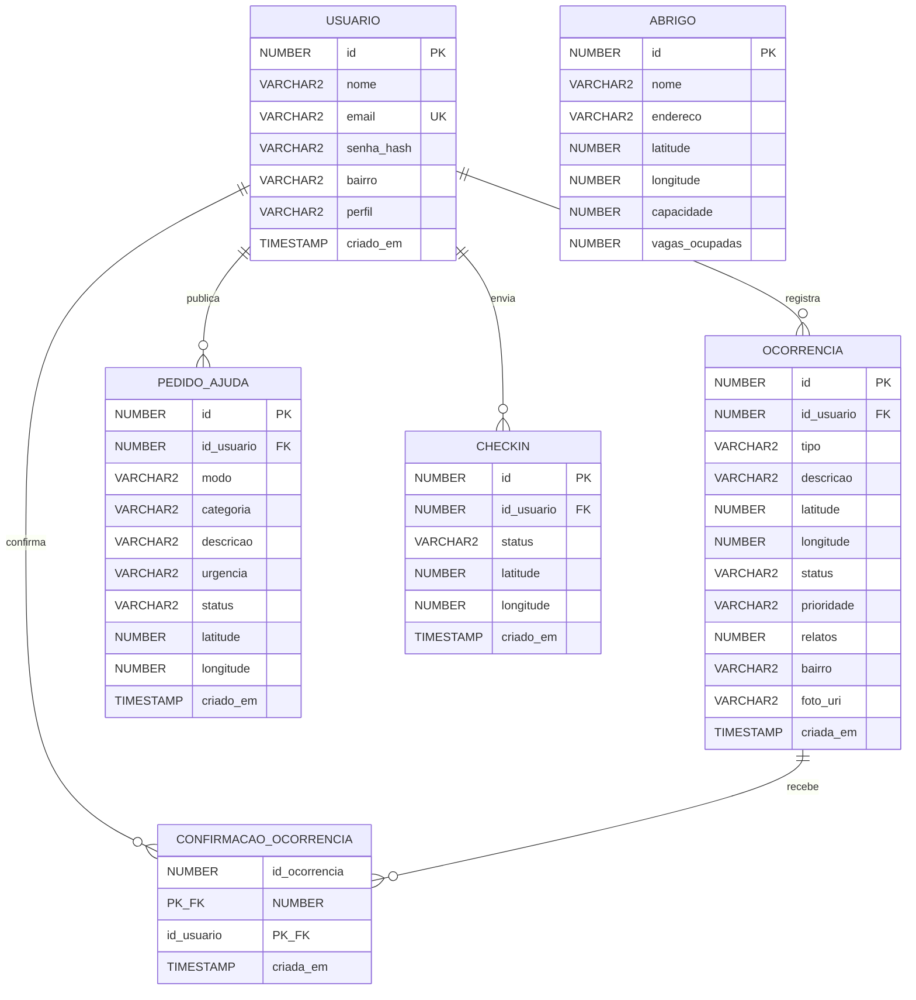

# AlertaBairro — Design do back-end, banco e automação PL/SQL

**Data:** 2026-11-17
**Entrega:** 19/11/2026 (Global Solution 2 — 2026, turma 3SIOA)
**Status:** aguardando aprovação

---

## 1. Intenção e o porquê

O app **AlertaBairro** (React Native + Expo + TypeScript) já existe e funciona com dados
falsos. Ele é uma rede comunitária para eventos climáticos extremos: moradores registram
ocorrências (alagamento, árvore caída, falta de luz, deslizamento), encontram o abrigo com
vaga mais próximo, pedem ou oferecem ajuda, e avisam que estão bem com um toque.

Falta tudo o que fica atrás dele: a API, o banco Oracle modelado, as rotinas PL/SQL, o
ambiente em Docker e a documentação que a Global Solution cobra.

Existe um back-end anterior (`backend-antigo/`, Node.js + Express) recebido como
referência. Ele **não** será continuado, e a seção 5 explica por quê. O que ele acertou —
a superfície de rotas, o modelo de privacidade e o mapeamento de erros — é preservado
como requisito de paridade.

O porquê imediato é a nota: a GS2 cobra DER, MER, rotinas PL/SQL que automatizem
processos, boas práticas de memória documentadas e um vídeo técnico de 5 minutos
explicando escolhas. O back-end antigo não entrega nenhum desses quatro.

### ODS atendido

**ODS 11 — Cidades e comunidades sustentáveis**, alvo 11.5 (reduzir mortes e perdas
causadas por desastres, com foco em população vulnerável). Secundário: **ODS 13**
(ação contra a mudança do clima, alvo 13.1 — capacidade de adaptação a desastres).
A ligação é direta: o app encurta o tempo entre "o bairro alagou" e "alguém sabe,
alguém foi atendido, e há registro disso".

---

## 2. Objetivos, não-objetivos, anti-objetivos

### Objetivos

1. API REST que sustenta as 3 funcionalidades do app de ponta a ponta, sem dados falsos.
2. Modelo de dados Oracle com DER e MER entregues como artefato versionado.
3. Rotinas PL/SQL que automatizam processos reais da solução — e que resistam à pergunta
   "por que isso está no banco e não no serviço?".
4. `docker compose up` sobe Oracle + API numa máquina limpa, sem instalar Oracle Client.
5. Os **mesmos** scripts de banco rodam no Docker e no Oracle da FIAP, sem edição à mão —
   garantido por construção (6.1) e documentado, não verificado contra a FIAP (ver 14).
6. Documentação que cobre o que o enunciado pede: funções/métodos/classes, README com
   execução e justificativas técnicas, e a seção de gerenciamento de memória.
7. Corrigir os dois defeitos de concorrência herdados (seção 5.3) — eles são o argumento
   central do vídeo técnico.

### Não-objetivos

- Mexer nas telas do app. O escopo no front é **um arquivo** (`servicos/api.ts`), em
  branch separada — ver 10.2.
- Upload de arquivo de imagem. O campo `fotoUri` continua texto (seção 7.4).
- Deploy em nuvem, CI/CD, HTTPS, observabilidade além de `/actuator/health`.
- Painel web administrativo.
- Notificação push.
- Os dois vídeos e o `links.txt` — são entregáveis seus, não meus.

### Anti-objetivos

Coisas que, se acontecerem, tornam a entrega um fracasso mesmo funcionando:

- **Rotina PL/SQL decorativa.** Uma procedure que só embrulha um `INSERT` para dizer que
  existe PL/SQL. Se eu não consigo justificar em uma frase por que ela está no banco, ela
  não entra.
- **Front quebrado.** O app precisa continuar funcionando com `USE_MOCK` ligado, para o
  caso de o banco cair na hora da gravação do vídeo.
- **Script que só roda aqui.** Qualquer DDL que exija privilégio de DBA ou sintaxe
  exclusiva do Oracle 23ai inviabiliza a entrega na FIAP.
- **Regra de negócio sem transação.** O defeito mais grave do back-end antigo; repeti-lo
  anula a justificativa da arquitetura nova.

---

## 3. Restrições

| # | Restrição | Origem | Consequência |
|---|---|---|---|
| R1 | Rotinas **PL/SQL** obrigatórias | enunciado | O banco é Oracle. Não há equivalente em Postgres/MySQL. |
| R2 | Scripts rodam no Docker **e** no Oracle da FIAP | decisão do usuário | Garantida **por construção** (6.1), validada só no Docker. Decisão sua: a FIAP não entra nesta entrega. |
| R3 | Máquina de desenvolvimento **ARM64** (Apple Silicon) | ambiente | Imagens Oracle XE 21 não têm ARM64. Ver 6.2. |
| R4 | O app é React Native e **não muda** (exceto `api.ts`) | decisão do usuário | O contrato HTTP é ditado pelo que as telas já consomem. |
| R5 | Mínimo 3 funcionalidades, login/cadastro não contam | enunciado | Mapa+ocorrências, abrigos+SOS, rede de ajuda+check-in. |
| R6 | Prazo: 19/11/2026, sem entrega atrasada | enunciado | Ver seção 10 (ordem e linha de corte). |
| R7 | Versão do Oracle da FIAP desconhecida | — | Escrevo para o menor denominador comum. Ver 6.1. |
| R8 | **Paridade** com as rotas e o app existentes | decisão do usuário | As 17 endpoints do v2 são o piso e o teto da superfície HTTP. Nada de rota nova sem aprovação — ver 13.6. |
| R9 | `README.txt` é o nome que o enunciado pede | enunciado | Entrego `README.md` (renderiza no GitHub) **e** `README.txt` com o mesmo conteúdo em texto puro. |

---

## 4. Decisões já tomadas

Tomadas por você na conversa, antes deste documento:

| Decisão | Escolha |
|---|---|
| Linguagem/plataforma do back | **Java 21 + Spring Boot 3** |
| Onde as regras moram | **Camadas no Spring + PL/SQL focado** (abordagem B, seção 9) |
| Escopo no front | Back completo + reescrever **só** a camada `servicos/api.ts` |
| Entrega do front | **Branch nova** no repositório existente, sem tocar na `main` |
| Banco de destino | Scripts portáveis: Docker **e** Oracle da FIAP |

O enunciado exige Kotlin, Flutter ou React Native apenas para o **app** — React Native já
cumpre. A linguagem do back-end é livre; Java foi escolha, não obrigação.

---

## 5. Estado atual: o que foi recebido

### 5.1 O front (`GlobalSolution26_App/`)

React Native + Expo + TypeScript, 10 telas, 3 funcionalidades completas. Camada única de
acesso em `src/servicos/api.ts` — as telas não conhecem HTTP, o que é exatamente o que
torna viável mexer em um arquivo só.

O repositório tem **duas cópias idênticas** do código (o pacote solto em `app/src/` e o
projeto Expo em `app/alertabairro/`). Verificado com `diff -rq`: não divergiram.

Estado: **v1**. Faz 9 chamadas HTTP, tem `USE_MOCK = true` e `BASE_URL` fixo em
`http://192.168.0.10:3000`.

### 5.2 O back-end anterior (`backend-antigo/`)

Node.js 20 + Express 5 + `node-oracledb`, 4 arquivos de código (507 linhas) e 4 de teste
(526 linhas). Documenta uma superfície **v2** de 17 endpoints.

**O que ele acertou e vai ser preservado:**

- As 17 endpoints e seus códigos HTTP (400/401/403/404/409/422/500).
- Privacidade de quem pede ajuda: a API nunca devolve lat/lng do solicitante, só a
  distância em texto (`"300 m"`, `"1,2 km"`).
- Flag `meu` em vez de expor `idUsuario` ao cliente.
- `RAISE_APPLICATION_ERROR(-20000..-20999)` → HTTP 422 com a mensagem repassada ao app.
  Isso faz o banco falar com o usuário final, e é um bom padrão.
- Login com mensagem única e tempo constante para e-mail inexistente e senha errada.
- Bind variables em todo o SQL.

### 5.3 O que está faltando ou quebrado

Isto é o diagnóstico que justifica recomeçar em vez de portar.

**(a) A pasta `database/` está vazia na prática — 25 linhas.**
Não existe DDL, nenhuma das 5 rotinas PL/SQL, nem DER, nem MER. O `README_BANCO.txt`
ainda contém o texto `[PESSOA 3/4: substituam este texto pelo README do banco]`. O único
arquivo SQL, `ajustes_api_v2.sql`, se declara "NAO testado em Oracle" e exige que alguém
substitua `<nome_da_constraint>` à mão. **A parte que o enunciado mais cobra não existe.**

**(b) As duas metades não se encaixam.**
O README do back manda rodar o app com `EXPO_PUBLIC_API_URL`; o front recebido não lê essa
variável. Front v1 (9 chamadas) contra back v2 (17 endpoints).

**(c) Conflito de domínio que quebra em runtime.**
`resolverPedido` grava `status = 'resolvido'`, mas o tipo `StatusPedido` do front só
conhece `'aguardando' | 'atendido'`, e a própria documentação do banco avisa que outro
valor "quebra as cores e filtros do app".

**(d) Não existe transação.**
`oracledb.autoCommit = true` é global. Em `PATCH /ocorrencias/:id {acao:"confirmar"}`,
gravar a confirmação e incrementar `relatos` são **dois commits independentes**. Se o
segundo falhar, o usuário gastou sua única confirmação e o contador não subiu — e não há
como desfazer.

**(e) Corrida em ler-depois-escrever.**
`atender` e `resolver` fazem `buscarOcorrencia(id)`, testam o status em JavaScript, e só
então fazem `UPDATE`, sem lock. Dois voluntários simultâneos passam ambos pelo teste
`status !== 'aberta'`. O mesmo padrão aparece em `confirmar`.

**(f) O PL/SQL nunca é testado.**
Os testes substituem o banco por um objeto em memória. `repositorio.test.js` apenas
verifica se o nome da procedure aparece na string SQL. Zero cobertura do que o enunciado
avalia.

**(g) Arquitetura.**
`app.js` tem 271 linhas misturando roteamento, validação, autenticação, máquina de
estados, cálculo de Haversine e tratamento de erro. Sem camadas, sem DTO, sem migrations,
sem Docker, sem OpenAPI. O README afirma que "as regras de negócio pesadas ficam no
banco", mas a máquina de estados — a regra mais importante — está em JavaScript, sem
transação (itens d e e).

---

## 6. A restrição mais difícil: um script, dois Oracles

### 6.1 Portabilidade do DDL e do PL/SQL

A versão do Oracle da FIAP é desconhecida (R7) e o container local é Oracle 23ai Free.
Escrever para o menor denominador comum custa pouco e remove o risco de a entrega não
rodar na infraestrutura do avaliador. Regras adotadas:

| Regra | Em vez de | Por quê |
|---|---|---|
| `SEQUENCE` + trigger `BEFORE INSERT` para PK | `GENERATED AS IDENTITY` | `IDENTITY` exige 12c+. Sequence+trigger roda de 11g a 23ai. Custo: 5 sequences e 5 triggers a mais. |
| Bloco PL/SQL com `EXCEPTION` nos drops | `DROP TABLE IF EXISTS` | `IF EXISTS` só existe no 23ai. |
| `VARCHAR2`/`NUMBER(1)` para flags | tipo `BOOLEAN` em SQL | `BOOLEAN` em coluna só no 23ai. |
| `SELECT ... FROM dual` sempre explícito | `VALUES` sem `FROM` | sintaxe sem `FROM` só no 23ai. |
| Tudo no schema corrente | `CREATE USER`, `TABLESPACE`, `GRANT` | a conta FIAP é um schema só, sem privilégio de DBA. |
| Job `DBMS_SCHEDULER` comentado e opcional | job obrigatório | pode estar bloqueado na FIAP. A rotina de encerramento funciona chamada pela API. |
| Status/prioridade sempre minúsculo e sem acento | `'Alta'`, `'CRÍTICA'` | os valores atravessam até o `switch` de cores do app. |

Os arquivos de migração são **SQL puro**, sem recurso específico de ferramenta, para que o
mesmo arquivo possa ser aberto no SQL Developer e executado à mão na entrega da FIAP.

### 6.2 O container Oracle em ARM64

`gvenzl/oracle-free:23-slim` (Oracle Database 23ai Free) tem imagem ARM64 nativa. As
imagens `oracle-xe:21` são apenas amd64 e dependeriam de emulação. O primeiro boot leva
alguns minutos, então o Compose usa healthcheck e `depends_on: service_healthy`, e um
volume nomeado para não repetir o boot inicial.

---

## 7. Modelo de dados

### 7.1 Entidades

Seis tabelas. Cinco vêm do back-end antigo; `CONFIRMACAO_OCORRENCIA` resolve o item 5.3(d).



`ABRIGO` é intencionalmente sem relacionamento: o app não cadastra abrigos e ninguém é
"dono" de um abrigo. A ligação com as pessoas é geográfica, calculada, não estrutural.

O DER (físico, acima) e o MER (conceitual/lógico, com cardinalidades em notação
Chen/Peter Chen e o dicionário de dados coluna por coluna) ficam em `docs/modelo-dados.md`,
em Mermaid — que o GitHub renderiza sozinho, sem imagem anexada.

### 7.2 Domínios de valor

Atravessam API, banco e o `switch` de cores do app, então são fixos:

| Coluna | Valores |
|---|---|
| `USUARIO.perfil` | `morador` · `idoso` · `voluntario` |
| `OCORRENCIA.status` | `aberta` · `em_atendimento` · `resolvida` |
| `OCORRENCIA.prioridade` | `normal` · `alta` · `critica` |
| `PEDIDO_AJUDA.modo` | `pedido` · `oferta` |
| `PEDIDO_AJUDA.urgencia` | `baixa` · `media` · `alta` |
| `PEDIDO_AJUDA.status` | `aguardando` · `atendido` · `resolvido` |
| `CHECKIN.status` | `estou_bem` · `preciso_de_ajuda` |

Todos com `CHECK constraint` nomeada — o banco recusa valor fora do domínio, mesmo que
alguém insira por fora da API.

### 7.3 O conflito do `'resolvido'` — minha decisão

O item 5.3(c) é um conflito real: o banco precisa dos três status (`resolvido` é o que
alimenta o Histórico), e o front só entende dois.

**Decisão:** o banco e a API carregam os três valores. O `api.ts` normaliza
`'resolvido' → 'atendido'` ao entregar para as telas, com comentário explicando.
Isso mantém o modelo de dados honesto, respeita "não tocar nas telas", e deixa a
normalização em um único lugar visível. Marcado no `api.ts` como ponto a remover quando
alguém adicionar o Histórico ao front.

### 7.4 Datas: offset obrigatório

`utils/geo.ts#tempoDecorrido` joga `criadaEm` direto em `new Date()`. Se a API serializar
sem offset, o "há X min" do app passa a mentir pelo fuso do container.

**Decisão:** toda data sai em ISO-8601 **com offset** (`2026-11-17T14:32:10-03:00`), e o
container da API roda com `TZ=America/Sao_Paulo`. As colunas são `TIMESTAMP` com default
`SYSTIMESTAMP`.

### 7.5 `foto_uri` — limite assumido

O app comprime a foto (1024px, JPEG 60%) e manda o caminho **local do dispositivo**.
Esse caminho não significa nada no servidor. Guardo o texto em `VARCHAR2(500)` e
documento o limite, como o back antigo fazia.

Não resolvo isso agora porque a solução de mercado (upload para object storage, API
devolvendo URL assinada) exige mexer na tela `NovaOcorrencia`, o que está fora do escopo.
Fica registrado em "trabalho futuro" no README — é um bom ponto para o vídeo mostrar que
o limite foi uma escolha, não um esquecimento.

---

## 8. Rotinas PL/SQL

O critério da abordagem B: **entra no banco o que fica mais barato ou mais correto no
banco.** Cada rotina abaixo passa no teste "justifique em uma frase".

| Rotina | Tipo | Por que no banco |
|---|---|---|
| `FN_ABRIGO_MAIS_PROXIMO(lat, lng)` | FUNCTION → NUMBER | Haversine sobre o conjunto todo, filtrando `vagas_ocupadas < capacidade`. Decidir no banco evita trafegar todos os abrigos para comparar fora. |
| `PRC_CONTROLE_VAGAS(id_abrigo, qtd)` | PROCEDURE | `SELECT ... FOR UPDATE` trava a linha. Dois voluntários simultâneos não passam da capacidade. O lock pertence a quem é dono do dado. |
| `TRG_OCORRENCIA_ESCALONA` | TRIGGER | `BEFORE UPDATE OF relatos FOR EACH ROW`: ao atingir 3 relatos a prioridade sobe um nível. Garantia de que nenhum caminho de escrita escapa da regra. |
| `PRC_ENCERRAR_PEDIDOS_ANTIGOS(dias, OUT qtd)` | PROCEDURE | `UPDATE` em lote + `SQL%ROWCOUNT`. Operação de conjunto; fazer em laço na aplicação seria uma ida ao banco por linha. |
| `PRC_REGISTRAR_OCORRENCIA(...)` | PROCEDURE | Deriva o `bairro` do `USUARIO`, define prioridade inicial, insere e devolve o id — **uma** ida ao banco, uma transação. Garante que o bairro gravado é o do usuário, sem segunda consulta. |
| `VW_INDICADORES` + `FN_OCUPACAO_ABRIGOS` | VIEW + FUNCTION | 11 agregações sobre 4 tabelas. Agregar no banco e trazer uma linha, em vez de trazer linhas para contar fora. |
| `TRG_<tabela>_BI` (5) | TRIGGER | Infraestrutura: PK via sequence, pela portabilidade decidida em 6.1. Não contam como automação. |

### 8.1 Por que estas rotinas e não outras

O enunciado lista, textualmente, os processos que ele espera ver automatizados. O conjunto
acima cobre essa lista item por item — não por acaso:

| O enunciado pede | Rotina que atende |
|---|---|
| "registro de solicitações" | `PRC_REGISTRAR_OCORRENCIA` |
| "acompanhamento de atendimentos" | `TRG_OCORRENCIA_ESCALONA` + máquina de estados com lock |
| "geração de indicadores" | `VW_INDICADORES` + `FN_OCUPACAO_ABRIGOS` |
| "controle de recursos" | `PRC_CONTROLE_VAGAS` |
| "outras operações relacionadas" | `FN_ABRIGO_MAIS_PROXIMO`, `PRC_ENCERRAR_PEDIDOS_ANTIGOS` |

O enunciado **não** exige `PACKAGE`, `CURSOR` explícito nem contagem mínima de objetos.
Se o seu tutor tiver um critério adicional nesse sentido, me avise: é a única coisa que
mudaria o escopo do passo 1.

### 8.2 Semântica fechada do escalonamento

- Dispara **uma vez**, na terceira confirmação (`:OLD.relatos < 3 AND :NEW.relatos >= 3`),
  subindo um nível. Não sobe de novo a cada confirmação seguinte — senão qualquer
  ocorrência popular viraria `critica` sozinha.
- Nunca escala ocorrência com status `resolvida`.
- `PRC_ENCERRAR_PEDIDOS_ANTIGOS` continua gravando `'atendido'`, não `'resolvido'`:
  `'resolvido'` significa "o autor resolveu", e encerramento automático por tempo não é
  o autor agindo.

Códigos de erro de negócio, mantidos do contrato anterior para a API traduzir em HTTP 422:

| Código | Mensagem |
|---|---|
| `-20001` | Usuario nao encontrado |
| `-20002` | Abrigo sem vagas suficientes |
| `-20003` | Abrigo nao encontrado |
| `-20004` | Quantidade de saida maior que as vagas ocupadas |
| `-20005` | Dados invalidos |

**Armadilha conhecida:** `TRG_OCORRENCIA_ESCALONA` é `FOR EACH ROW` na própria
`OCORRENCIA`, então **não pode** fazer `SELECT` nela — seria `ORA-04091` (table is
mutating). A regra olha apenas `:NEW`, sem consulta. A variante "somar relatos de
ocorrências próximas num raio" exigiria compound trigger e fica fora do escopo,
registrada como trabalho futuro.

---

## 9. Arquitetura da API

### 9.1 Camadas

```
web/         Controller · DTO (records) · @RestControllerAdvice
  ↓          Bean Validation nos DTOs de entrada
service/     regras de fluxo · @Transactional · autorização por perfil
  ↓
repository/  JdbcClient (SQL) · SimpleJdbcCall (procedures/functions)
  ↓
Oracle       tabelas · constraints · rotinas PL/SQL
```

Regra de dependência: só para baixo. O `service` não conhece HTTP; o `repository` não
conhece regra de negócio. Isso é o oposto do `app.js` de 271 linhas descrito em 5.3(g).

### 9.2 Escolhas técnicas e por quê

| Escolha | Alternativa descartada | Motivo |
|---|---|---|
| **Spring JDBC** (`JdbcClient`, `SimpleJdbcCall`) | JPA/Hibernate | O projeto é PL/SQL-cêntrico. JPA abstrai justamente o que preciso controlar: chamada de procedure, bind de parâmetro `OUT`, SQL explícito. Com JDBC o SQL fica visível e revisável. |
| **Maven** | Gradle | Padrão do `start.spring.io` e o que a disciplina usa. Menos atrito. |
| **Spring Security + Resource Server (JWT HS256)** | jjwt/java-jwt na mão | `NimbusJwtDecoder.withSecretKey` dá validação de assinatura, expiração e algoritmo fixo sem código próprio. Perfil vira `ROLE_VOLUNTARIO` e a autorização vira `@PreAuthorize` — substitui o `soVoluntario()` manual. |
| **BCryptPasswordEncoder** (custo 10) | mesmo | Compatível com os hashes bcrypt do back antigo. |
| **Bean Validation** nos DTOs | validação manual | Substitui as ~15 chamadas de `exigir()`. A regra fica junto do campo, declarativa. |
| **Flyway** | script solto na pasta | O `ajustes_api_v2.sql` com `<nome_da_constraint>` para editar à mão é exatamente o problema que migração versionada resolve. Exige `flyway-database-oracle`. Os arquivos continuam SQL puro (6.1). |
| **springdoc-openapi** | nenhuma | Swagger UI dá uma lista clicável de 17 endpoints: é o que faz as rotas que o app não usa aparecerem no vídeo de 5 minutos. |
| **Testcontainers** (`gvenzl/oracle-free:23-slim`) | mock em memória | Fecha o buraco 5.3(f): o teste roda o Flyway de verdade e exercita as rotinas PL/SQL de verdade. É o diferencial mais forte da entrega. |
| **Actuator** | `/health` escrito à mão | `/actuator/health` já traz o estado do pool e do banco. |

### 9.3 Onde cada regra mora

A tabela abaixo é a resposta à pergunta que o vídeo técnico precisa responder.

| Regra | Onde | Por quê |
|---|---|---|
| Validação de formato de entrada | `web` (Bean Validation) | Rejeitar o mais cedo possível, antes de ocupar conexão de banco. |
| "só voluntário pode atender/resolver" | `service` (`@PreAuthorize`) | É política de acesso, não integridade de dado. |
| "só o autor exclui" | `service` | Idem. |
| Máquina de estados da ocorrência | `service` `@Transactional` + `SELECT FOR UPDATE` | **Corrige 5.3(e).** Lê com lock, decide, escreve, commita — uma transação. |
| Confirmação + incremento de `relatos` | `service` `@Transactional` | **Corrige 5.3(d).** Os dois passos num commit só: ou ambos, ou nenhum. |
| Escalonamento de prioridade | **banco** (trigger) | Garantia estrutural: vale para qualquer caminho de escrita. |
| Capacidade do abrigo | **banco** (procedure + `FOR UPDATE` + `CHECK`) | Lock e invariante onde o dado mora. |
| Abrigo mais próximo | **banco** (function) | Operação de conjunto. |
| Encerrar pedidos antigos | **banco** (procedure) | Operação de conjunto em lote. |
| Indicadores | **banco** (view) | Agregação. |
| Distância exibida e privacidade | `web` (mapper de DTO) | É formatação e política de exposição, não dado. A lat/lng do solicitante nunca sai do servidor. |

### 9.4 Superfície HTTP

As 17 endpoints do v2, preservadas. 🔒 = exige JWT; 🦺 = só perfil `voluntario`.

| Método | Rota | Usada pelo app |
|---|---|---|
| `GET` | `/actuator/health` | não |
| `POST` | `/auth/cadastro` | sim |
| `POST` | `/auth/login` | sim |
| `GET` | `/ocorrencias` 🔒 | sim |
| `POST` | `/ocorrencias` 🔒 | sim |
| `PATCH` | `/ocorrencias/{id}` 🔒 (`confirmar` · `atender` 🦺 · `resolver` 🦺) | só `confirmar` |
| `DELETE` | `/ocorrencias/{id}` 🔒 (autor) | não |
| `GET` | `/abrigos` 🔒 | sim |
| `GET` | `/abrigos/proximo?lat=&lng=` 🔒 | sim |
| `PATCH` | `/abrigos/{id}/vagas` 🔒🦺 | não |
| `GET` | `/ajuda` 🔒 | sim |
| `POST` | `/ajuda` 🔒 | sim |
| `PATCH` | `/ajuda/{id}` 🔒 (autor, `resolver`) | não |
| `DELETE` | `/ajuda/{id}` 🔒 (autor) | não |
| `POST` | `/ajuda/encerrar-antigos` 🔒🦺 | não |
| `POST` | `/checkins` 🔒 | sim |
| `GET` | `/indicadores` 🔒 | não |

As 7 rotas que o app não usa ficam demonstráveis pelo Swagger UI no vídeo técnico.
Códigos de erro: `400` entrada inválida · `401` token · `403` perfil · `404` inexistente ·
`409` conflito de estado · `422` regra recusada pelo banco (`ORA-20xxx`) · `500` interno.
Corpo de erro sempre `{ "erro": "mensagem" }`, como o app já espera.

### 9.5 Gerenciamento de memória e eficiência

Seção exigida pelo enunciado. O que de fato será aplicado:

- **Pool de conexões** (HikariCP) dimensionado e com limite máximo — conexão Oracle é o
  recurso caro, e pool sem teto derruba o banco antes da API.
- **Paginação obrigatória** (`limite` ≤ 200, `deslocamento`) em toda listagem: o tamanho
  do heap usado por requisição fica limitado por contrato, não por sorte.
- **`fetchSize` no JDBC** alinhado ao limite de página, para não materializar o cursor todo.
- **DTO com projeção** — o `SELECT` lista as colunas que o DTO usa; nunca `SELECT *`.
  `senha_hash` não é projetado em nenhuma consulta de leitura.
- **Agregação e filtro no banco** (view de indicadores, function de distância): trazer uma
  linha em vez de trazer N para reduzir fora.
- **Uma ida ao banco por operação** via procedure com parâmetro `OUT` — sem N+1.
- **`@Transactional(readOnly = true)`** nas leituras: evita o custo de flush/dirty-check e
  deixa a intenção explícita.
- **JVM ciente do container**: `-XX:MaxRAMPercentage` em vez de `-Xmx` fixo, para o heap
  respeitar o limite do Docker em vez de ignorá-lo.
- **Imagem final com JRE** (multi-stage: build com Maven, runtime só com JRE 21) —
  imagem menor, menos superfície.
- **Corpo de requisição limitado** (100 KB), como no back antigo: impede que um POST
  grande vire pressão de memória.

A seção correspondente do app (FlatList virtualizada, `React.memo`, `useMemo`,
compressão de foto) já está escrita em `README_APP.txt` e será incorporada ao README final.

---

## 10. Entregáveis e ordem

A entrega fica em **dois repositórios**, por decisão sua: o back-end novo, e o front
existente recebendo a alteração em **branch separada**. O `.txt` da entrega leva os
**dois links**.

Como o enunciado fala de "um" link, o `README.md` de cada lado abre apontando para o
outro, para que o avaliador que abrir qualquer um dos dois ache o conjunto completo. Esse
é o preço da opção por dois repositórios, e está mitigado, não eliminado.

### 10.1 Repositório novo (back-end)

```
alertabairro-api/
├── pom.xml · Dockerfile · src/   Spring Boot (Maven) na raiz: o repositório É a API
├── database/                     migrações SQL puras: DDL, rotinas PL/SQL, carga, testes
├── docs/
│   ├── modelo-dados.md           DER + MER + dicionário de dados
│   └── superpowers/              este documento
├── docker-compose.yml            Oracle 23ai Free + API
├── README.md · README.txt        execução, justificativas, memória, ODS, link do front
└── links.txt                     GitHub + vídeos (você preenche)
```

Nome do repositório e pastas em inglês, por convenção de mercado. Os nomes de **domínio**
(tabelas, rotinas PL/SQL e rotas) seguem em português: são contrato fechado com o app e
com a API anterior, e traduzi-los quebraria a paridade exigida em R8.

Como o enunciado pede **um** GitHub com "código-fonte, README e modelo de dados", o
`README.md` deste repositório abre apontando para o repositório do app e para a branch da
integração, para o avaliador não precisar procurar.

### 10.2 Front: branch nova, sem tocar na `main`

A alteração vai em branch no repositório existente
(`luanaestanislau/GlobalSolution26_App`), nunca na `main` — é código de outra pessoa.

- Branch sugerida: `feat/integracao-api-real`.
- Um arquivo de conteúdo: `servicos/api.ts`.
- **Atenção:** o repositório tem duas cópias idênticas do front (`app/src/` e
  `app/alertabairro/src/`, confirmado por `diff -rq` na seção 5.1). As duas recebem a
  mesma alteração, senão elas divergem e a próxima pessoa não sabe qual vale.
- `USE_MOCK` continua funcionando: a branch não pode tirar do app a capacidade de rodar
  sem a API (anti-objetivo da seção 2).
- Você tem push no repositório, então a branch vai direto para o remoto e tem URL para o
  README do back apontar.
- Abrir PR ou mesclar na `main` é decisão sua; eu paro na branch com o commit empurrado.

Ordem de execução, com linha de corte pensada no prazo de dois dias:

1. **Banco** — DDL portável + 6 rotinas PL/SQL + carga inicial de abrigos + script de teste.
2. **Docker** — Compose com Oracle e healthcheck, validado subindo de zero.
3. **API** — camadas, segurança, as 17 endpoints, tratamento de erro.
4. **Integração** — branch `feat/integracao-api-real` no repositório do front com o
   `api.ts` reescrito nas duas cópias; app rodando contra a API real.
5. **DER/MER + README** — documentação completa.
6. **Testcontainers** — suíte que exercita o PL/SQL de verdade.

Os passos 1 a 5 são o mínimo entregável. O passo 6 é o que mais distingue a entrega, e por
isso vem logo depois do mínimo estar fechado — não antes, para não arriscar o prazo.

---

## 11. Riscos

| Risco | Mitigação |
|---|---|
| Primeiro boot do Oracle 23ai leva minutos e parece travado | Healthcheck no Compose, volume nomeado, e o tempo esperado escrito no README. |
| Versão do Oracle da FIAP incompatível com algo | Seção 6.1 — menor denominador comum. Os scripts são SQL puro, executáveis à mão no SQL Developer. **Risco aceito:** por decisão sua não haverá teste contra a FIAP, então isso fica garantido por disciplina de escrita, não por verificação. |
| Flyway exige dependência específica para Oracle | `flyway-database-oracle` no `pom.xml`; validado no passo 2, antes de a API existir. |
| Testcontainers depende de Docker na máquina do avaliador | Perfil de teste separado: `mvn test` roda os unitários sem Docker; a suíte de integração é opt-in. |
| Prazo de dois dias | Ordem da seção 10 com linha de corte explícita após o passo 5. |
| Charset do Oracle da FIAP e os acentos (`'Árvore caída'`) | Identificadores e domínios de valor são ASCII; só o conteúdo digitado tem acento. Testado na carga inicial. |

---

## 12. O que fica a critério de quem implementa

- Nomes de pacotes Java, de classes e a divisão interna de cada camada.
- Versão exata do Spring Boot 3.x (a estável no `start.spring.io` no momento da criação).
- Formato de log e nível por pacote.
- Nomes das constraints e dos índices, desde que nomeados e não gerados pelo Oracle.
- Como o `api.ts` lê a URL base (variável de ambiente Expo ou arquivo de configuração),
  desde que `USE_MOCK` continue funcionando como alternativa.
- Dados da carga inicial de abrigos, desde que coerentes com as coordenadas que as telas
  já usam (região central de São Paulo, ~-23.55 / -46.63).

---

## 13. Decisões fechadas após a revisão técnica

Uma revisão independente do documento levantou seis pontos. Quatro eu resolvi aqui e
estão marcados como **minha decisão** — confira ao ler, porque são meus e não seus.
Os outros dois estão na seção 14.

### 13.1 `distancia` nunca mais "desconhecida" — minha decisão

**O problema encontrado:** o back antigo calculava a distância a partir de `?lat&lng`
opcionais ou, na falta deles, do último check-in do usuário. Mas o front não manda
coordenada nenhuma em `listarPedidos()` nem em `criarPedido()`. Num banco recém-criado
ninguém fez check-in — então **todo** cartão da aba Ajuda apareceria como
`"distância desconhecida de você"`. Numa das três funcionalidades avaliadas, no vídeo.

**A decisão:** o `api.ts` reescrito passa a anexar a coordenada em `GET /ajuda` e
`POST /ajuda`, usando o `obterLocalizacao()` que o app já tem.

Três motivos pelos quais isso é barato:

1. `Ajuda.tsx` **já importa** `obterLocalizacao` (usa no botão "Estou bem"), então não há
   permissão nova sendo pedida numa tela que não pedia.
2. `servicos/localizacao.ts` nunca lança erro: se a permissão for negada, devolve
   `COORDENADA_PADRAO`. Logo a distância sempre tem de onde ser calculada.
3. `GET /ajuda ?lat=&lng=` e `POST /ajuda {latitude?, longitude?}` **já existem** no
   contrato v2. Isso é paridade (R8), não superfície nova.

O fallback para o último check-in continua no servidor, como segunda linha.

### 13.2 Migrações só criam; quem derruba é outro script — minha decisão

A seção 6.1 previa "bloco PL/SQL com `EXCEPTION` nos drops". Combinado com a possibilidade
de o schema da FIAP ser compartilhado com outras disciplinas, isso é perigoso: `USUARIO` é
um dos nomes de tabela mais colidíveis que existem, e um script de reset rodado no lugar
errado apaga trabalho de outra matéria.

**A decisão:** as migrações versionadas são **create-only**. Todo `DROP` fica isolado em
`database/reset_environment.sql`, fora da sequência de migração, com um aviso no topo do arquivo
e no README de que ele é para o Docker local. Nenhum caminho automático executa esse
arquivo.

### 13.3 Dados de demonstração: script opt-in, e a receita do trigger — minha decisão

Num `docker compose up` limpo o Mapa nasce vazio e a aba Ajuda também. Pior: demonstrar
`TRG_OCORRENCIA_ESCALONA` pelo app exige **três contas**, porque `relatos` começa em 1 e
ninguém confirma a própria ocorrência — registra com A, confirma com B, confirma com C, e
só então a prioridade sobe.

**A decisão:** `database/seed_demo.sql`, opt-in, **fora** das migrações versionadas (pelo
mesmo motivo de 13.2 — não pode cair no schema da FIAP). Contém três usuários de
demonstração com hash bcrypt de senha conhecida, algumas ocorrências em estágios
diferentes, pedidos e ofertas, e check-ins. O README traz a receita de três contas como
roteiro de gravação, para o trigger ser demonstrável pelo app e não só pelo SQL Developer.

### 13.4 `README.md` e `README.txt` — minha decisão

O enunciado pede, com essas palavras, "README.txt com instruções de execução e
justificativas técnicas". Entrego os dois: `README.md` para renderizar no GitHub e
`README.txt` em texto puro com o mesmo conteúdo, porque é o nome que foi cobrado.

### 13.5 Paginação e a tela de Detalhe — limite documentado, sem rota nova

`Detalhe.tsx` não busca uma ocorrência: ele chama `listarOcorrencias()` e faz
`r.find(x => x.id === id)`. Com a paginação obrigatória da seção 9.5 (`limite` ≤ 200), a
tela deixaria de achar qualquer ocorrência fora da primeira página.

A correção limpa seria `GET /ocorrencias/{id}`. **Não vou adicionar**, porque você pediu
paridade com as rotas existentes (R8) e uma rota nova é justamente o que a paridade
exclui. Fica como limite documentado no README: a tela de Detalhe depende de a ocorrência
estar entre as 200 mais recentes, o que nenhum cenário de demonstração alcança.

Se preferir a correção em vez do limite, é uma rota e meia hora — me diga e eu incluo.

---

## 14. Perguntas abertas — respondidas

Nenhuma pendência. As três respostas:

| Pergunta | Resposta | Efeito |
|---|---|---|
| De qual repositório o grupo entrega? | **Repo novo pro back**, dois links no `.txt` | Seção 10.1: o front não é copiado; cada README aponta para o outro repositório. |
| Push no repositório do front? | **Sim** | Seção 10.2: branch empurrada para o remoto, com URL linkável. |
| O Oracle da FIAP entra nesta entrega? | **Não** — só precisa ser capaz de rodar lá | R2 e seção 11: escrita defensiva (6.1) e documentação. Sem segundo profile do Spring, sem postura especial de Flyway. Economiza o passo que o prazo de dois dias não paga. |
